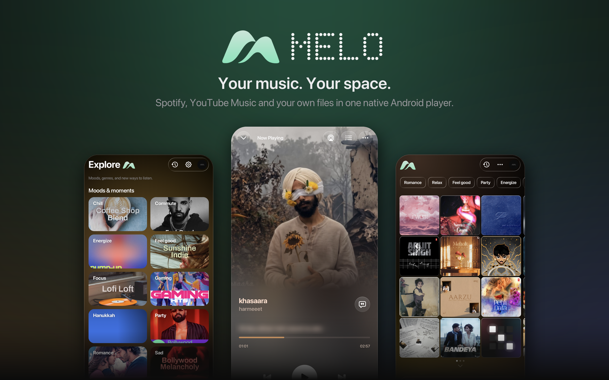
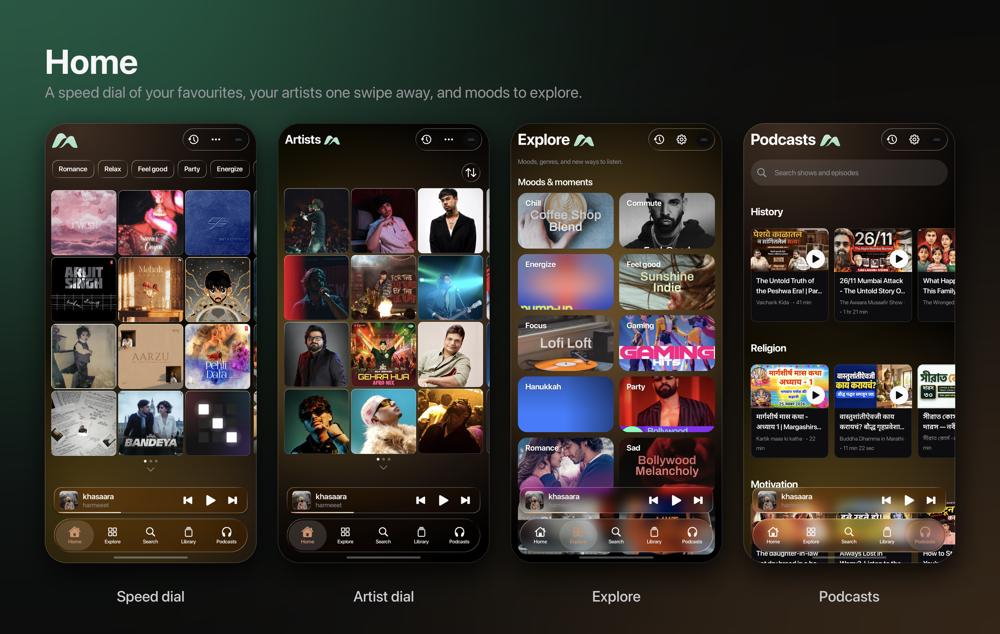
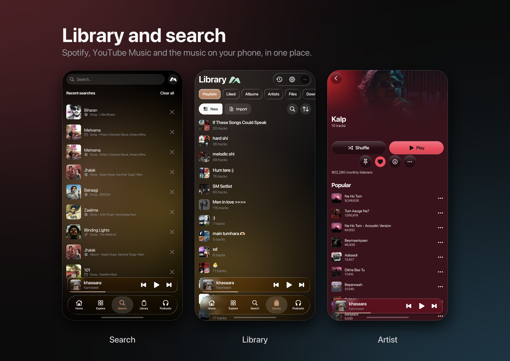
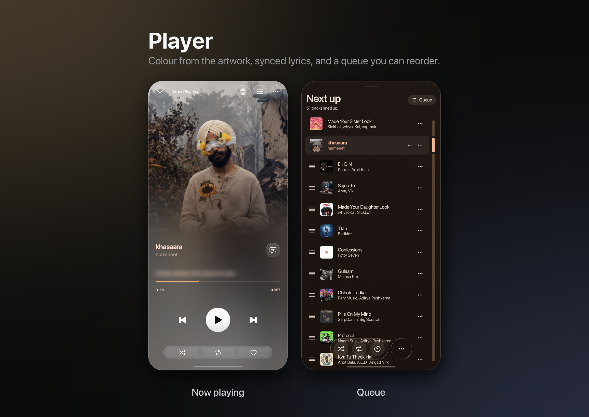
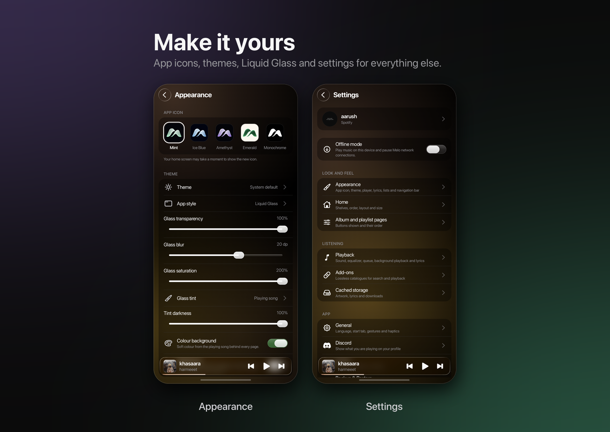
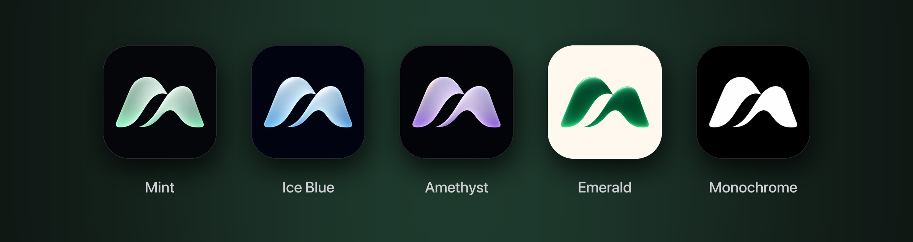
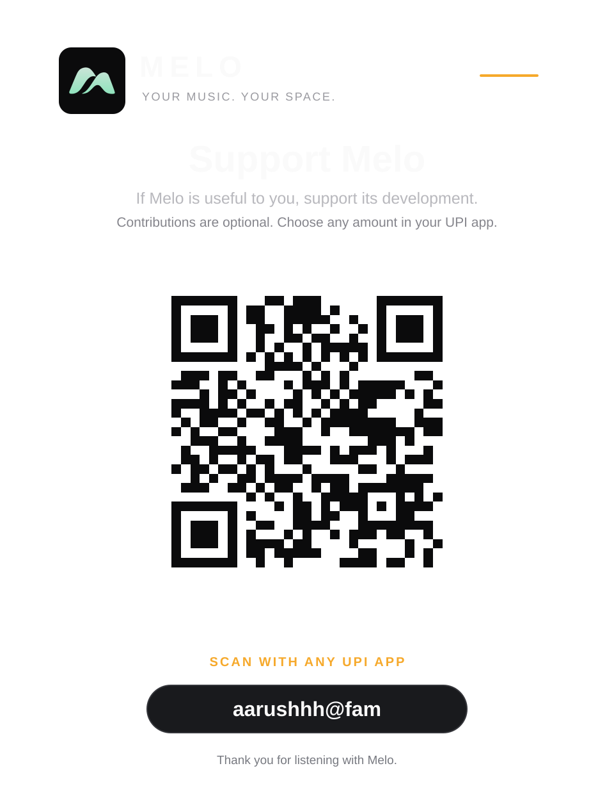

<picture>
  <source media="(prefers-color-scheme: dark)" srcset="docs/assets/img/readme/melo-logo-dark.png" />
  
</picture>

### Your music. Your space.

Spotify, YouTube Music and the music on your phone, in one native Android player.

[**Download**](#download) · [**Screenshots**](#screenshots) · [**Features**](#features) · [**Support**](#support) · [**Credits**](#credits)

 

> [!IMPORTANT]
> Melo is an independent project. It is not affiliated with, endorsed by or connected to Spotify, YouTube or Google.

---

## Screenshots

---

## Features

### Home
- **Speed Dial.** Your pinned songs, albums, playlists and artists in a grid, the first thing you see.
- **Artist dial and Mixes.** The artists you play most, and mixes from Spotify and YouTube Music, a swipe away.
- **I’m feeling lucky.** One tile that starts something you are likely to love.
- **Explore and Podcasts.** Moods, genres and shows, with your listening history close by.

### Library and search
- **One library.** Spotify, YouTube Music, your downloads and the files on your phone, together.
- **Search everywhere at once**, or narrow it to a single source.
- **Add-ons.** Lossless catalogues for search and playback, matched to the track you are playing.

### Player
- **Colour from the cover.** The player, and every page behind it if you like, takes its colours from the artwork.
- **Lyrics, word by word.** Synced and immersive, and shareable as a still card or a video of the lines lighting up.
- **Canvas** loops behind the controls on songs that have one.
- **A queue you can reorder**, with history, a sleep timer and shuffle that stays on if you want it to.
- **Quality you choose.** Low, Normal, High or Lossless, set apart for Wi-Fi and mobile data.

### Make it yours
- **Five app icons.** Mint, Ice Blue, Amethyst, Emerald and Monochrome. The splash screen opens in the colour you pick.
- **Liquid Glass.** Adjust transparency, blur, saturation and tint, or switch to a solid style.
- **Equalizer, volume normalization and gestures**, from swipe actions to the start tab.
- **Discord presence.** Show what you are playing, with your choice of status, wording and buttons.

And more: downloads, offline mode, Cast, backups, and updates from inside the app.

 

---

## Download

Get the latest APK from [**Releases**](https://github.com/aarush-io/melo/releases/latest). Melo runs on Android 8.0 and later. Each release has three files:

| File | For |
| --- | --- |
| `Melo-vX.Y.Z-arm64-v8a.apk` | Most phones from the last several years. Try this one first. |
| `Melo-vX.Y.Z-armeabi-v7a.apk` | Phones with a 32-bit system, including many Android Go phones. |
| `Melo-vX.Y.Z.apk` | Every device. A little larger; the in-app updater uses this one. |

Open the file on your phone and approve the install. If Android asks, allow the app you downloaded it with to install unknown apps. Melo keeps its own sign-in, settings and downloads, apart from any other music app.

Melo checks for new releases and walks you through updating. See [how updates work](docs/FAQ.md#how-do-application-updates-work), and the [FAQ](docs/FAQ.md) for accounts, devices and playback.

---

## Support

Melo is free. If it has earned a place in your rotation, you can support it with a voluntary UPI contribution: scan with any UPI app and choose an amount.

UPI ID: `aarushhh@fam`

---

## Contribute

Bug reports, device testing, documentation and code are all welcome. Start with the [contribution guide](CONTRIBUTING.md); to compile Melo yourself, see [building from source](docs/BUILDING.md). When reporting a bug, include your Melo version, Android version, device model and the steps to reproduce it. For security issues, see [SECURITY.md](SECURITY.md).

---

## Credits

- [BitChord](https://github.com/kushagrasinghx/BitChord) by kushagrasinghx: add-on support and add-on track matching are adapted from it.
- [Dial](https://github.com/steeben/Dial) by steeben: several interface ideas, such as the dials on Home, follow its lead.
- [Resona](https://github.com/code-saksham-hash/Resona): the YouTube Music integration.
- [Kizzy](https://github.com/dead8309/Kizzy): the Discord presence gateway.
- [Doto](https://github.com/google/fonts/tree/main/ofl/doto): the dot-matrix wordmark, under the [SIL Open Font License](design/Doto-OFL.txt).

## Legal

Melo is distributed under the [GNU General Public License v3](LICENSE). Third-party names and marks belong to their owners. For data and privacy, see [PRIVACY.md](PRIVACY.md).
